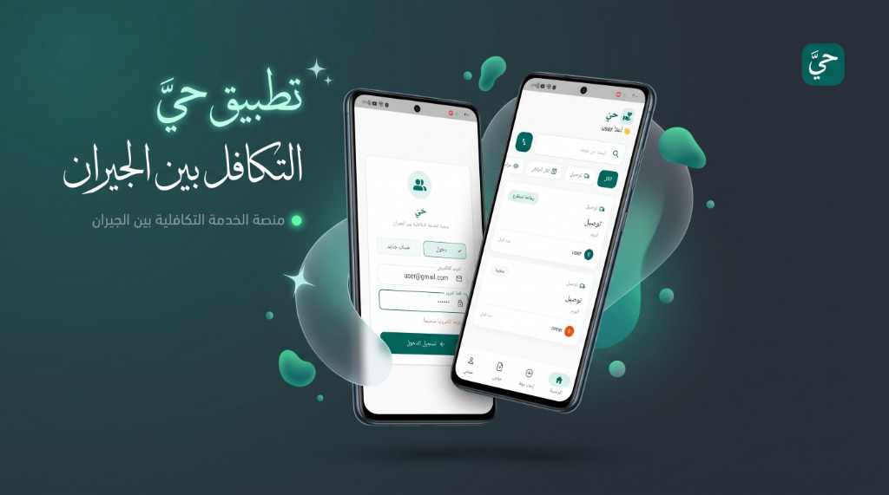
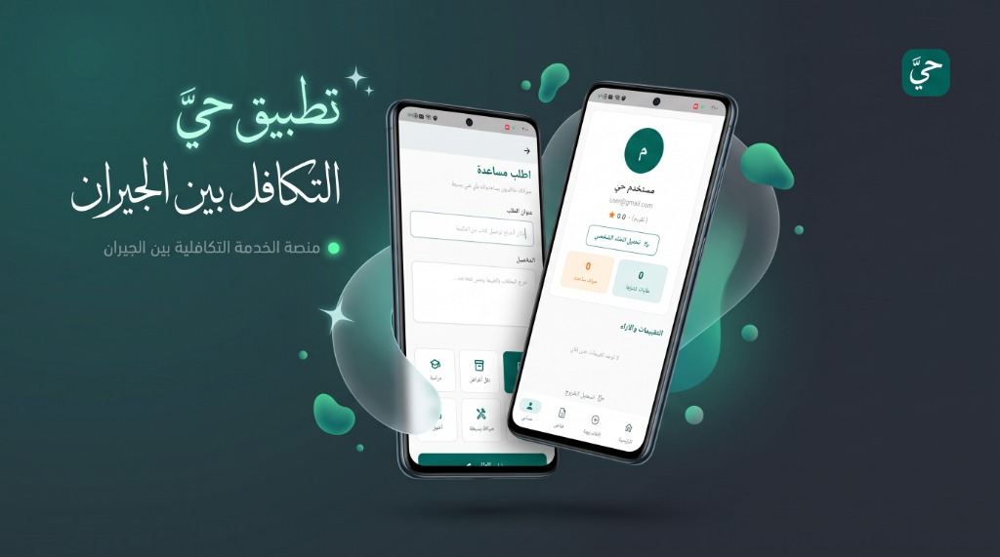
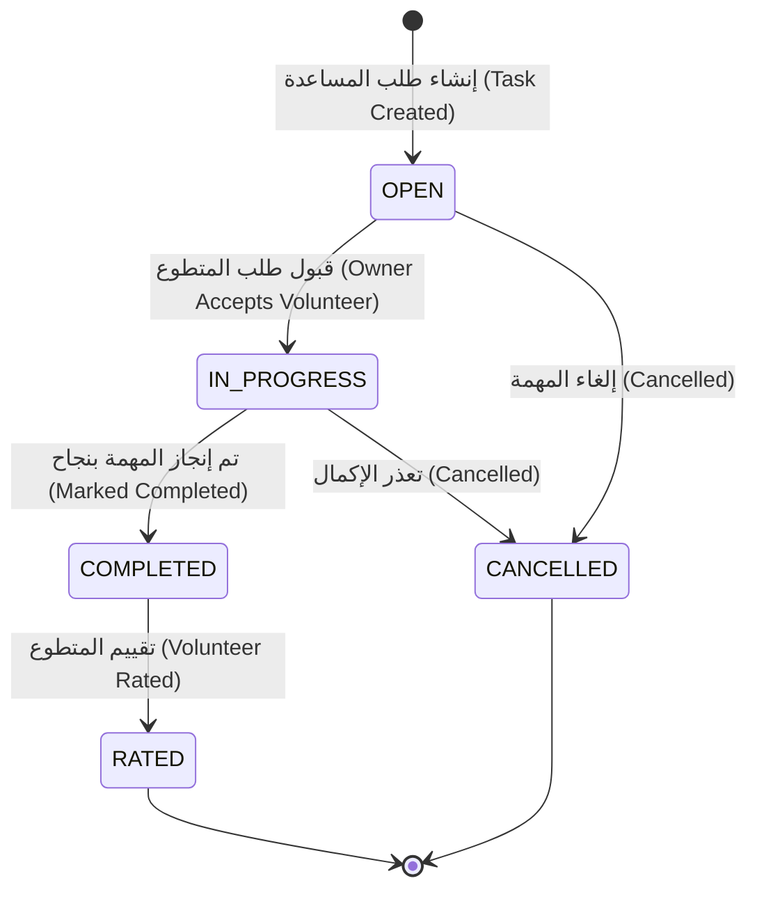

# 🏘️ تطبيق حَيّ | Hayy Community Platform
### منصة الخدمة التكافلية بين الجيران | Neighborly Mutual Aid & Solidarity Platform

<p align="center">
  
  
  
  
  
  
  
</p>

---

## 📸 لقطات من التطبيق | App Previews

<p align="center">
  
  
</p>

---

## 📖 جدول المحتويات | Table of Contents
- [عن التطبيق (Arabic)](#-عن-التطبيق)
  - [المميزات الرئيسية](#-المميزات-الرئيسية)
  - [المعمارية والتقنيات المستخدمة](#-المعمارية-والتقنيات-المستخدمة)
  - [المتطلبات الأساسية للتشغيل](#-المتطلبات-الأساسية-للتشغيل)
  - [طريقة التحميل والتشغيل خطوة بخطوة](#-طريقة-التحميل-والتشغيل-خطوة-بخطوة)
- [About The Project (English)](#-about-the-project)
  - [Key Features](#-key-features)
  - [Tech Stack & Architecture](#-tech-stack--architecture)
  - [Prerequisites](#-prerequisites)
  - [Installation & Setup Guide](#-installation--setup-guide)
- [دورة حياة المهمة | Task Lifecycle](#-دورة-حياة-المهمة--task-lifecycle)
- [هيكل المشروع | Project Structure](#-هيكل-المشروع--project-structure)
- [الترخيص وفريق العمل | License & Authors](#-فريق-العمل--authors)

---

<div dir="rtl">

## 🌟 عن التطبيق

**تطبيق حَيّ (Hayy)** هو تطبيق محمول تكافلي يهدف إلى إحياء روح التعاون والتكافل الاجتماعي بين سكان الحي الواحد والقرية والمجتمع المحلي.  
يتيح التطبيق للمستخدمين نشر طلبات المساعدة البسيطة (مثل: المساعدة في نقل الأغراض، صيانة منزلية خفيفة، إعارة واستعارة الأدوات، المساعدة الدراسية، والتوصيل الطارئ)، بينما يتمكن الجيران الراغبون في الخير من التطوع لتقديم المساعدة بكل سهولة وموثوقية، مع نظام تقييم متبادل يعزز الثقة والأمان داخل المجتمع.

### ✨ المميزات الرئيسية
1. **نشر طلب مساعدة:** إضافة طلب جديد مع تحديد العنوان، التفاصيل، والفئة (توصيل، نقل أغراض، دراسة، صيانة بسيطة).
2. **منظومة التطوع والتكافل:** استعراض طلبات الجيران في الحي، والتقدم للتطوع بمساعدة الجار.
3. **إدارة دورة حياة المساعدة:** إمكانية قبول المتطوع المناسب، تحويل الطلب إلى (قيد التنفيذ)، ثم (مكتمل).
4. **نظام التقييم والآراء (Rating & Reviews):** بعد إتمام الخدمة يتم تقييم المتطوع وترك انطباع عنه لتعزيز موثوقية الأعضاء.
5. **الملف الشخصي المتكامل:** إحصائيات بعدد مرات المساعدة والتطوع، الطلبات المنشورة، ومتوسط التقييم.
6. **مصادقة آمنة وسريعة:** تسجيل الدخول بـ البريد الإلكتروني وكلمة المرور عبر Firebase Authentication مع توثيق JWT على السيرفر.

### 🛠️ المعمارية والتقنيات المستخدمة
- **تطبيق الجوال (Frontend):**
  - مبني بأحدث إصدارات **Flutter & Dart**.
  - إدارة الحالة النظيفة عبر **Bloc / Cubit Pattern**.
  - تقسيم الطبقات وفق معمارية Clean Architecture / MVVM (`Data`, `Domain`, `Presentation`).
  - الاتصال الشبكي عبر حزمة **Dio**.
  - مصادقة Firebase وحفظ الحالات عبر `SharedPreferences`.
- **الخادم وقاعدة البيانات (Backend):**
  - إطار عمل **Laravel 10** مع **PHP 8.1+**.
  - قاعدة بيانات **MySQL** لتخزين المهام، التقييمات، والتطوع.
  - ميدلوير أمان للتحقق من رموز Firebase ID Token وتحويلها لـ JWT.
  - بنية برمجية RESTful API محكمة.

---

### 💻 المتطلبات الأساسية للتشغيل
قبل البدء بتشغيل المشروع، تأكد من تثبيت الأدوات التالية على جهازك:
- **Git** (لنسخ المشروع وإدارته).
- **Flutter SDK** (الإصدار 3.0.0 فما فوق).
- **PHP** (إصدار 8.1 أو أحدث) + **Composer**.
- **MySQL Database** (مثل XAMPP أو Laragon أو MySQL Server مستقل).
- بيئة تطوير: **VS Code** أو **Android Studio**.
- جهاز حقيقي بنظام أندرويد أو محاكي (Emulator) مفعّل.

---

### 🚀 طريقة التحميل والتشغيل خطوة بخطوة

#### 1️⃣ استنساخ المشروع (Clone Repository)
```bash
git clone https://github.com/ENG-Ebraheem/hayy-community.git
cd hayy-community
```

#### 2️⃣ إعداد وتشغيل السيرفر (Laravel Backend)
1. انتقل لمجلد الـ Backend وثبّت الحزم:
   ```bash
   cd backend
   composer install
   ```
2. انسخ ملف البيئة وأنشئ مفتاح التطبيق:
   ```bash
   cp .env.example .env
   php artisan key:generate
   ```
3. افتح ملف `.env` وقم بضبط إعدادات قاعدة بياناتك (MySQL):
   ```env
   DB_CONNECTION=mysql
   DB_HOST=127.0.0.1
   DB_PORT=3306
   DB_DATABASE=hayy_db
   DB_USERNAME=root
   DB_PASSWORD=
   ```
4. قم بإنشاء قاعدة البيانات `hayy_db` في MySQL، ثم نفّذ الهجرة والبيانات الأولية:
   ```bash
   php artisan migrate --seed
   ```
5. شغّل خادم التطوير المحلي:
   ```bash
   php artisan serve --host=0.0.0.0 --port=8000
   ```

#### 3️⃣ إعداد وتشغيل تطبيق الموبايل (Flutter Frontend)
1. في نافذة طرفية (Terminal) جديدة، توجه لمجلد الموبايل:
   ```bash
   cd mobile
   ```
2. حمّل حزم ومكتبات Flutter:
   ```bash
   flutter pub get
   ```
3. *(ملاحظة Firebase)*: تأكد من إضافة ملف `google-services.json` داخل مسار `mobile/android/app/` في حال رغبتك بالربط مع مشروع Firebase الخاص بك.
4. اضبط عنوان الـ API في كود الفلاتر (في حال التشغيل على محاكي أندرويد استخدم `http://10.0.2.2:8000/api` أو الآيبي المحلي `IP` لجهازك عند التجربة على هاتف حقيقي).
5. شغّل التطبيق:
   ```bash
   flutter run
   ```

</div>

---

<div dir="ltr">

## 🌟 About The Project

**Hayy Community Platform** is a neighborly mutual-aid and social solidarity mobile application designed to strengthen cooperation and support within local neighborhoods and communities.  
The app empowers neighbors to request simple assistance (e.g., delivery, moving items, minor home repairs, tool loans, tutoring), while willing neighbors can quickly step up and volunteer. A mutual rating and review system ensures accountability, safety, and transparency.

### ✨ Key Features
1. **Post Help Requests:** Create tasks with details, category tags, and location/description.
2. **Volunteer & Support:** Browse open neighborhood requests and offer help with a single tap.
3. **Structured Task Workflow:** Task status seamlessly transitions from Open to In-Progress to Completed.
4. **Ratings & Feedback:** Mutual rating system after task completion to build a trusted neighborhood circle.
5. **Detailed User Profile:** Real-time stats on completed requests, hours/times helped, and overall rating.
6. **Secure Authentication:** Integrated with Firebase Auth & JWT Middleware for token verification.

### 🛠️ Tech Stack & Architecture
- **Mobile Client (Flutter):**
  - **Flutter 3.x & Dart**.
  - State management powered by **flutter_bloc / Cubit**.
  - Layered architecture following Clean Architecture / MVVM principles (`Data`, `Domain`, `Presentation`).
  - Networking with **Dio** and local caching with **SharedPreferences**.
- **Server API (Laravel):**
  - **Laravel 10** RESTful API built on **PHP 8.1+**.
  - **MySQL** relational database with Eloquent ORM.
  - JWT verification middleware for Firebase credentials.

---

### 💻 Prerequisites
Ensure you have the following installed on your environment:
- **Git**
- **Flutter SDK** (3.0.0+)
- **PHP** (8.1+) & **Composer**
- **MySQL Database Server** (XAMPP, Laragon, or standalone MySQL)
- **Android Studio** or **VS Code** with Flutter extensions.

---

### 🚀 Installation & Setup Guide

#### 1. Clone the Repository
```bash
git clone https://github.com/ENG-Ebraheem/hayy-community.git
cd hayy-community
```

#### 2. Backend Setup (Laravel)
```bash
cd backend
composer install
cp .env.example .env
php artisan key:generate

# Configure your DB connection in .env:
# DB_DATABASE=hayy_db

php artisan migrate --seed
php artisan serve --host=0.0.0.0 --port=8000
```

#### 3. Mobile Setup (Flutter)
```bash
cd ../mobile
flutter pub get

# Place your google-services.json inside mobile/android/app/
# Ensure API baseUrl matches your host machine IP (or 10.0.2.2 for Android Emulator)

flutter run
```

</div>

---

## 🔄 دورة حياة المهمة | Task Lifecycle



---

## 📁 هيكل المشروع | Project Structure

```
hayy-community/
├── backend/                   # Laravel 10 API
│   ├── app/
│   │   ├── Http/Controllers/  # Controllers (Auth, Tasks, Volunteers, Ratings)
│   │   ├── Http/Middleware/   # FirebaseAuthMiddleware
│   │   └── Models/            # Eloquent Models (User, Task, Rating)
│   ├── database/migrations/   # Database schemas
│   ├── routes/api.php         # RESTful API endpoints
│   └── composer.json
│
├── mobile/                    # Flutter Mobile Application
│   ├── lib/
│   │   ├── core/              # Network config (Dio), themes, utilities
│   │   ├── features/          # Feature-first modular structure
│   │   │   ├── auth/          # Login, Register, Firebase Auth
│   │   │   ├── tasks_home/    # Neighborhood tasks listing & filters
│   │   │   ├── create_task/   # New help request submission
│   │   │   ├── task_details/  # Task details & volunteering flow
│   │   │   ├── profile/       # User profile & statistics
│   │   │   └── ratings/       # Ratings & reviews system
│   │   └── main.dart          # Flutter App Entrypoint
│   └── pubspec.yaml
│
├── docs/                      # Screenshots & Documentation
│   └── screenshots/
│       ├── hayy_preview_1.jpg
│       └── hayy_preview_2.jpg
│
├── .gitignore                 # Preconfigured ignores for Flutter & Laravel
└── README.md                  # Comprehensive Documentation
```

---

## 👥 فريق العمل | Authors

- **م/ إبراهيم وزملاؤه** - مطورو تطبيق حيّ (مشروع تكليف لمادة برمجة الهواتف المتقدمة - Flutter).
- Developed as an advanced university project demonstrating full-stack mobile development using Flutter & Laravel.

---

<p align="center">Made with ❤️ for community service and neighborhood solidarity</p>
